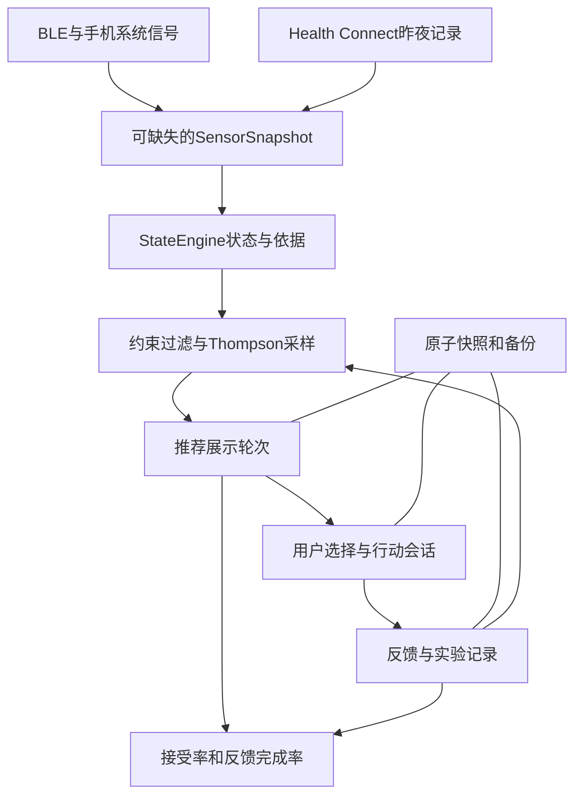

# v0.28 架构

v0.28 新增 F-50：系统文件选择器 → PersonaDocumentReader（有界 IO 读取）→ PersonaDocument（纯逻辑 TXT/MD/DOCX 解析）→ 预览 → 自定义草稿 → PersonaStore 原子保存。模型请求沿用当前设定注入，未保存的草稿不会进入请求。当前设定参与业务备份；局部撤销副本不导出，业务恢复时清除。

原有状态、推荐和行动架构如下；R1 的 F-44–F-49 来源迁移与主流程重构仍待实现。本版文件导入只在 Android 提供，网页继续为不接模型的演示。

UI在当前重组中构造包含实时心率的快照，主动陪伴复用当前评估；刷新协程只更新数据源。logic下的规则、采样、时间与编码可在JVM验证；data/ble负责平台接口与持久化。

Repo先原子保存再发布不可变快照。选择与会话同时提交；完成反馈以sessionId去重。推荐记录最多5000轮，DEMO单列；报告不从历史反馈倒推不存在的展示。

可选大模型对话是独立网络路径，基础状态与推荐可离线。进程退出后的准点提醒、真实睡眠源、长期耗电仍需平台验证。当前详情和指标以04、05及v0.27-validation为准。
