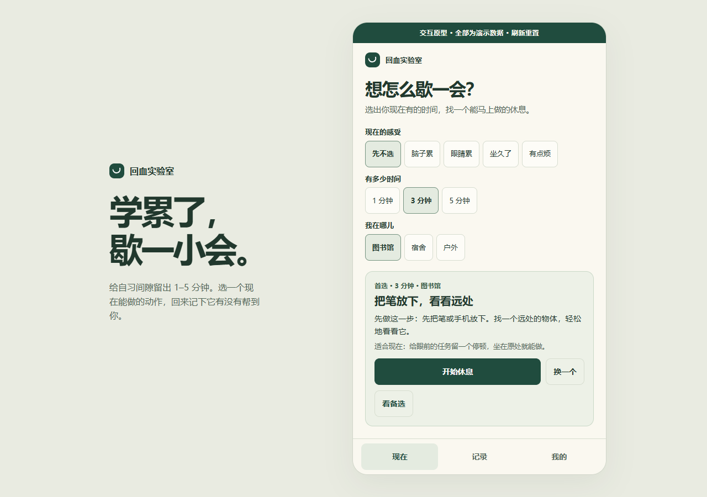

# 回血实验室：产品重规划

> 决策日期：2026-11-27（北京时间）｜规划版本：R1｜工程基线：v0.27 / `33b069e`
>
> 本目录是下一阶段的产品定义、交互原型和实施任务。**不是新版 App 发布说明；规划功能尚未在 Android 实现，真实用户研究尚未执行。** R1 主流程仍未实现；当前发布版已由后续 R2 增补更新为 [v0.28](../../README.md)。

## R2 用户新增要求

用户随后确认陪伴设定可由文档导入，F-50 已独立交付为 v0.28，详见 [R2 增补](07-persona-import.md)。R1 的 F-44–F-49 仍待实现，后续版本号以实际发布为准。

## 产品经理的决定

**保留「回血实验室」名称，聚焦「学习间隙的个人休息助手」。** 先服务使用 Android、经常在图书馆或自习室独立学习的大学生。让用户在约 30 秒内选定一件当下可做的 1–5 分钟休息，再用自己的反馈找到值得再试的方法。30 秒是待验证的设计目标，不是已有性能结论。

这次重做调整的是主线、信息结构、数据可信度与验收顺序。继续使用现有 Kotlin / Compose、端侧推荐、计时与存储能力；不另起一套技术栈。

| 决策 | 落点 |
| --- | --- |
| 一个核心任务 | 我现在学不进去了，做什么能短暂休息、然后回到自己的事情？ |
| 一个主入口 | 选择时间与场景，得到一个首选；可展开最多两个备选 |
| 三个一级页面 | 现在 / 记录 / 我的；行动库作为二级入口 |
| 无设备也完整可用 | 无手环、无使用统计权限、无模型 Key，仍能进行真实使用 |
| 数据先于换皮 | 先补真实/演示隔离、会话关联与旧数据迁移，再扩大试用 |
| 缩减首屏负担 | 状态总分、角色聊天、设备配置退出首次使用主路径 |
| 成功依据 | 用户能独立完成、愿意跨日再用；不以停留时长或心率下降作为成功 |

## 阅读和执行顺序

1. [产品定位与取舍](01-strategy.md)：为什么重做，服务谁，哪些功能暂缓。
2. [产品需求与验收](02-prd.md)：功能、数据边界、异常和迁移契约。
3. [页面与交互](03-experience.md)：页面职责、具体文案、状态和原型范围。
4. [实施任务与里程碑](04-delivery-plan.md)：依赖、优先级、完成条件和发布门槛。
5. [用户验证与指标](05-validation.md)：访谈、可用性测试、14 天试用及计算口径。
6. [可点击交互原型](prototype/index.html)：下载仓库后直接用浏览器打开；GitHub 文件预览不会执行网页。
7. [本轮核验记录](06-review.md)：规划复核、浏览器检查、截图和未验证边界。

## 当前完成与未完成

- 已完成：仓库与现有证据审计、产品方向决策、需求拆解、流程设计和可点击设计原型。
- 未完成：F-44 至 F-49 的 Android 实现、生产数据迁移、新版本发布、用户招募和实际试用。
- 当前代码仍有待修的数据来源问题，详见 PRD；不能拿旧演示记录证明新定位成立。
- R1 当轮仅交付规划与设计附件；后续 R2 的 F-50 已独立发布为 v0.28，历史 v0.27 证据保留。

旧功能 F-01 至 F-43 和缺陷编号保持不变。新功能编号在本目录预留，只有实现并验收后才能写入已完成列表。参赛材料随当前实际发布版更新；R1 的规划功能不能写成已实现。
